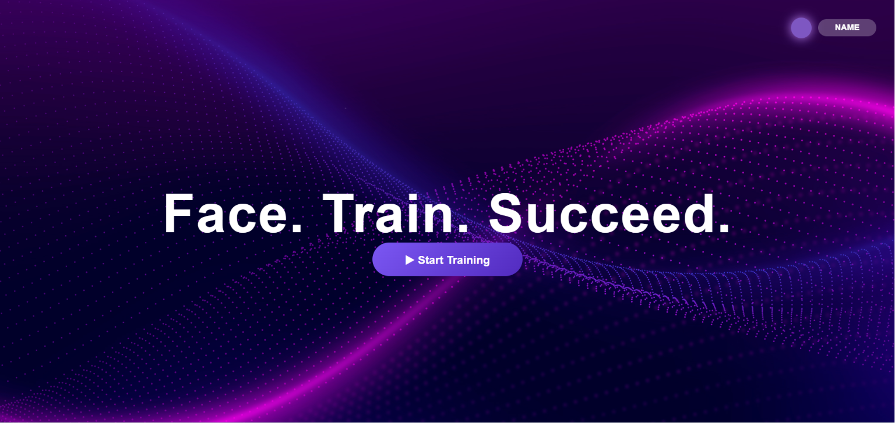
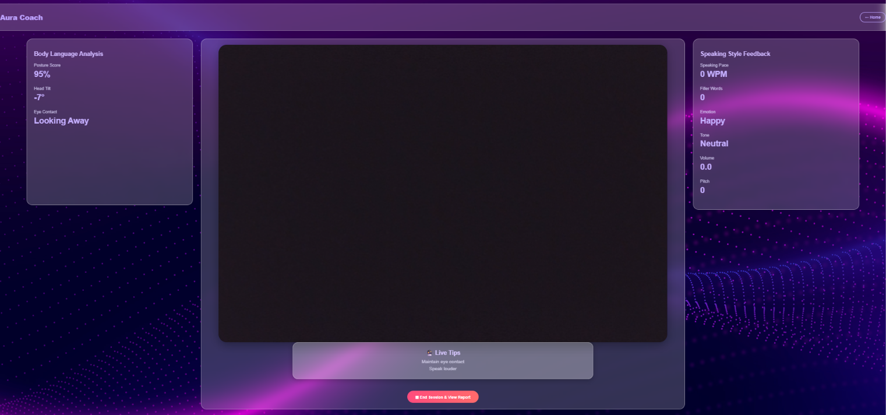

# Aura Coach

A real-time public-speaking coach. Turn on your camera and mic, start talking, and Aura Coach watches your body language and listens to your voice — live — then scores the whole session with a trained ML model at the end.

## What the dashboard actually shows

The live training screen is a three-panel layout: your camera feed in the center, with two stat panels on either side that update continuously while you speak.

**Body Language Analysis** (left panel)
- **Posture Score** — a 0–100% shoulder-level score from MediaPipe Pose landmark tracking
- **Shoulder Tilt** — current aspect-ratio-corrected shoulder line angle in degrees
- **Camera Alignment (approx.)** — Good / Looking Away, estimated from nose horizontal centering relative to the frame (a proxy for facing the camera, not true eye-gaze tracking; internal model key remains `eyeContact` for trained-pipeline compatibility)

**Speaking Style Feedback** (right panel)
- **Speaking Pace (incl. pauses)** — live words-per-minute computed from finalized browser SpeechRecognition transcripts over elapsed capture time
- **Filler Words (heuristic)** — running count of finalized single-word ("um", "uh", "like", "basically", "actually") and multiword ("you know", "I mean", "kind of", "sort of") fillers
- **Expression Estimate** — facial expression estimate via `face-api.js` (e.g. Happy, Neutral)
- **Tone** — vocal tone classified live as Calm / Balanced / Energetic / Noise from 1.5-second resampled audio windows
- **Volume (RMS×100)** — current loudness on the `RMS × 100` scale
- **Pitch** — current fundamental frequency (Hz) on voiced windows (`Unavailable` during silence)

**Live Tips** (below the camera) — short, real-time nudges generated from your current metrics (e.g. "Low mic input level", "Straighten your shoulder alignment", "Center yourself toward the camera").

After you end a session, the **Report page** shows a summary, rule-based insights/recommendations, and an **ML Performance Score (0–100)** from the trained regressor — not just an average of the raw numbers, but a model that's learned how these metrics interact (e.g. fast pace only hurts the score when filler words are also high).

There's also a **Session History** page listing all past sessions so you can track whether posture, pace, fillers, etc. are trending in the right direction over time.

## How it works under the hood

- **Frontend (React)** — captures webcam/mic, runs MediaPipe Pose for body tracking and face-api.js for facial expression, streams audio to the backend over a WebSocket, and renders the live dashboard + report.
- **Backend (FastAPI)** — receives the audio stream, extracts acoustic features (loudness, pitch, spectral centroid, zero-crossing rate via `librosa`), runs the tone classifier on each chunk in real time, logs session data, and builds the post-session report.
- **ML models (scikit-learn, RandomForest)** — trained on 78 real recorded sessions, replacing what used to be hand-written if/else thresholds:

  | Model | Task | Test MAE / Accuracy | Test R² / CV |
  |---|---|---|---|
  | Performance Regressor | 0–100 session score from wpm, posture, fillers, volume, pitch, eyeContact, tone, emotion | ~1.9 pts | R² ~0.96, 5-fold CV MAE ~3.1 |
  | Tone Classifier | Calm / Balanced / Energetic / Noise from 5 acoustic features | ~98% accuracy | 5-fold CV ~99.6% |

  On the performance model, **posture (54%) and speaking pace (19%) are the biggest drivers** of the score, per its feature importances — eye contact comes next. Full training details, why these are real learned models rather than thresholds, and retraining instructions are in `README_ML.md`.

## Pages

### Home Page
Landing screen with an animated typing headline ("Face. Train. Succeed.") over a full-bleed background, a user avatar bar top-right, and a single **▶ Start Training** button that drops you into a live session. Minimal by design — no setup steps, no settings to configure first.



### Training Page
The core of the app — a live session screen, split into three columns:

- **Center:** your live camera feed (this is also where MediaPipe Pose draws posture landmarks and face-api.js reads expression).
- **Left — Body Language Analysis:** Posture Score, Head Tilt, Eye Contact, updating continuously.
- **Right — Speaking Style Feedback:** Speaking Pace (WPM), Filler Words, Emotion, Tone, Volume, Pitch.
- **Below the camera — Live Tips:** short real-time nudges generated from your current metrics (e.g. "Speak louder" when volume is low).
- **Start Session** button at the bottom to begin/end recording.

This is the screen shown in the example below — note all the right-panel stats sit at 0 until the WebSocket to the backend is connected and audio starts streaming.



### Report Page
Shown after you end a session:

- **Session Summary card** — the headline **🧠 Estimated Performance Score (heuristic model)** badge (0–100, from the trained regressor; withheld if essential metrics WPM or posture were not measured) alongside session averages: WPM, Posture, Camera Alignment, Volume, Expression.
- **Pacing & Posture Timeline** — a dual-axis line chart plotting actual timestamped Posture (%) and Speaking Pace (WPM) checkpoints recorded during the session. For legacy sessions or short runs without recorded timeline checkpoints, it displays `No session timeline recorded` instead of fabricating trend points.
- **Insights** — rule-based observations on what happened in the session.
- **Recommendations** — concrete suggestions for the next attempt.


### Session History Page
A simple list of all past sessions ("Previous Sessions"), letting you click back into any earlier report to compare progress over time — useful for tracking whether posture, fillers, or pace are trending the right direction across multiple practice runs.


> **Adding screenshots:** create a `docs/screenshots/` folder in the repo root, drop in PNGs with the filenames referenced above, and the image links throughout this section will render automatically on GitHub.

## Project structure

```
aura-coach-fixed/
├── backend/
│   ├── main.py              # FastAPI app: WebSocket audio stream, session/report endpoints
│   ├── model_loader.py      # Loads the .joblib models at startup
│   ├── ml/                  # Training scripts + audio feature extraction
│   ├── models/              # Trained model artifacts (.joblib + metadata)
│   └── requirements.txt
├── src/
│   ├── pages/
│   │   ├── HomePage/           # Landing page
│   │   ├── TrainingPage/       # Live session: camera, dashboard, live tips
│   │   ├── ReportPage/         # Post-session summary + ML score
│   │   └── SessionHistoryPage/ # Past sessions list
│   └── App.js
├── public/models/             # face-api.js model weights (served statically)
├── data/raw/                  # Saved session JSONs (gitignored)
├── dockerfile
└── package.json
```

## Prerequisites

- Node.js 18+ and npm
- Python 3.10+ (last run on 3.13)
- A webcam and microphone

## Setup

**1. Environment variables**

```bash
cp .env.example .env
```
Default points the frontend at `http://localhost:8010` — fine for local dev as-is.

**2. Backend**

```bash
cd backend
python -m venv venv
source venv/bin/activate      # Windows: .\venv\Scripts\Activate.ps1
pip install -r requirements.txt
```
Trained models are already in `backend/models/`. To retrain (e.g. after collecting more sessions), see `README_ML.md`.

**3. Frontend**

```bash
npm install
```

## Running locally

Two terminals, both running at the same time:

```bash
# Terminal 1 — backend
cd backend
uvicorn main:app --reload --port 8010

# Terminal 2 — frontend
npm start
```

Open `http://localhost:3000`, click **Start Session**, allow camera/mic access.

## API overview

| Endpoint | Method | Purpose |
|---|---|---|
| `/api/audio-stream` | WebSocket | Streams mic audio, returns live tone/volume/pitch predictions |
| `/api/session/log` | POST | Logs a completed session's data |
| `/api/report/{session_id}` | GET | Full report for a session, including the ML performance score |
| `/api/predict/performance` | POST | Score an arbitrary feature set (testing / what-if) |
| `/api/sessions` | GET | List saved sessions |
| `/api/models/status` | GET | Health check confirming both ML models loaded |

## Docker & Deployment

```bash
docker build -t aura-coach .
docker run -p 10000:10000 aura-coach
```

The multi-stage `Dockerfile` builds the React frontend (`npm run build`) and serves it from the FastAPI container alongside the pre-trained `.joblib` models in `backend/models/` (it does **not** retrain models during build).

## Supported Browsers, Audio Flow & Limitations

- **Supported browsers:** Desktop Chromium browsers (**Google Chrome** or **Microsoft Edge**) are required for full functionality because the Web Speech API (`SpeechRecognition` / `webkitSpeechRecognition`) is not supported in Firefox and has limited continuous-mode behavior in Safari. When SpeechRecognition is unavailable or microphone permission is denied, WPM and fillers are reported as `Unavailable` (`null`) rather than `0`.
- **Audio sample-rate & windowing flow:** The browser reads the actual hardware `AudioContext.sampleRate` (commonly 44.1 kHz or 48 kHz) and sends a `{type: "start", session_id, sample_rate, channels: 1, encoding: "pcm_s16le"}` handshake before streaming binary PCM16LE packets. The backend accumulates a rolling **1.5-second analysis window** with a **0.5-second hop**, resamples the complete window to **16 kHz** via `scipy.signal.resample_poly`, and extracts features (`rms`, `pitch_mean`, `pitch_std`, `spectral_centroid`, `zero_crossing_rate`). On session stop, the client sends `{type: "finish"}` and awaits `{type: "finished"}` before calling `POST /api/session/log`.
- **Model caveats:**
  - `backend/models/tone_model.joblib` was trained on synthetic 1.5 s @ 16 kHz waveforms (`train_tone_model.py`), not labeled human speech recordings. Silence/unvoiced windows report `pitch: null` and `tone: null`.
  - `backend/models/performance_model.joblib` was trained on 78 historical session JSONs whose target score was bootstrapped from a heuristic formula (`compute_target_score` in `train_performance_model.py`), not external human ratings. When essential inputs (`wpm` or `posture`) are unmeasured (`null`), the score is withheld (`null`).
  - Both models were serialized with `scikit-learn==1.8.0` and `numpy>=2.0`, which are pinned in `backend/requirements.txt`.
- **Session storage, privacy & Render ephemerality:**
  - Completed sessions are written atomically as JSON files under `data/raw/` (or `AURA_DATA_DIR`), which is gitignored. Raw audio waveforms and raw transcripts are **not** persisted to disk.
  - In-memory audio summaries (`AUDIO_SUMMARIES`) are bounded with a TTL and live inside a single Uvicorn process (not shared across multiple workers).
  - On Render's free tier (`render.yaml`), the container filesystem is **ephemeral**: saved sessions in `/app/data/raw` are reset whenever the service redeploys or restarts unless backed by a persistent disk.
  - **CORS & WebSocket protocol:** In single-service Render deployment, the frontend and FastAPI backend share the same origin (`https://` and `wss://`). For separate frontend origins, set `ALLOWED_ORIGINS` (comma-separated explicit origins).