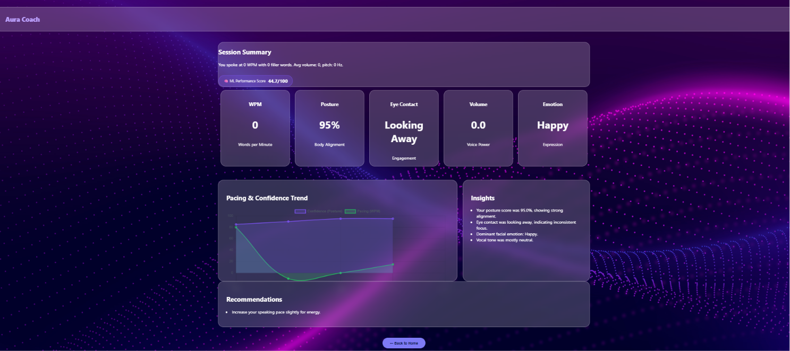
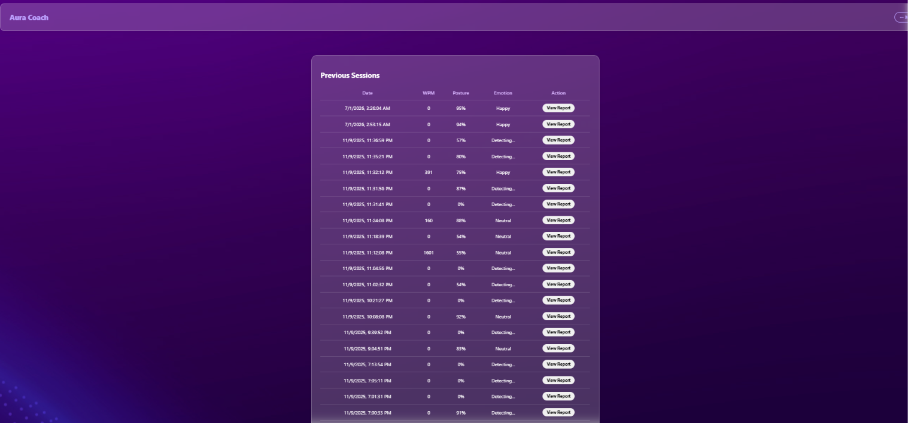

# Aura Coach

A real-time public-speaking coach. Turn on your camera and mic, start talking, and Aura Coach watches your body language and listens to your voice — live — then scores the whole session with a trained ML model at the end.

**🚀 Live demo: [aura-coach-1.onrender.com](https://aura-coach-1.onrender.com/)**  
<sub>Use Chrome or Edge and allow camera + microphone. Hosted on Render's free tier — the first load after a period of inactivity can take ~30–60 s while the service wakes up, and session history resets on each redeploy.</sub>

## What the dashboard actually shows

The live training screen is a three-panel layout: your camera feed in the center, with two stat panels on either side that update continuously while you speak. Any metric that can't be measured right now shows **—** (or a short status such as *Head not detected*, *No face*, *Listening…*) instead of a made-up 0.

**Body Language Analysis** (left panel, MediaPipe Pose in the browser)
- **Posture Score** — 0–100% from shoulder-line levelness (computed in pixel space, so it no longer changes with how close you sit) plus a capped "head sinking toward shoulders" penalty measured against your own first 3 seconds. A heuristic, not a clinical posture measure.
- **Head Tilt** — roll of the **head** in degrees, from the eye line (falls back to the ear line if an eye is hidden). `+` = tilted toward your right shoulder. Tilting your shoulders does not change it.
- **Eye Contact** — Good / Looking Away / Unknown. An estimate of whether your **face is oriented toward the camera** (nose position between the eye corners for yaw, nose drop vs. eye line for pitch), calibrated during the first ~2 s of a session, smoothed with hysteresis. It works wherever you sit in the frame. It does not track irises, so eyes-only glances aren't detected — it is not a medical eye-tracker.

**Speaking Style Feedback** (right panel)
- **Speaking Pace** — finalised recognised words ÷ elapsed session time (pauses included). Each final speech-recognition result is counted once, across recognition restarts. Shows *N/A* where the browser has no speech recognition.
- **Filler Words** — "um", "uh", "umm", "er", "hmm", "basically", phrases "you know", "I mean", "kind of", "sort of", and "like" only in filler contexts ("and like", "so like", sentence-initial).
- **Emotion** — facial **expression** from face-api.js, smoothed over ~3 s (confidence-gated probability averaging + hysteresis). An expression label, not a reading of how you feel.
- **Tone** — Calm / Balanced / Energetic / Noise from the Random Forest tone classifier, run on 1.5 s windows every 0.5 s and averaged over the last 3 windows. *Listening…* during silence, *Analyzing…* while the first window fills.
- **Volume** — mic signal RMS × 100 (same units the models were trained with). Uncalibrated: it depends on your mic and distance.
- **Pitch** — median pitch of voiced speech (librosa pYIN) over the last ~0.75 s, in Hz.

**Live Tips** (below the camera) — appear only after a condition has held for 1.5 s and clear 1 s after it stops, and only from valid measurements: posture, eye contact, head level, *Speak louder* (only while you're actually speaking quietly), mic clipping, filler words (≥3 in the last minute), *Great energy!*, and *You're doing great*.

After you end a session, the **Report page** shows a summary, rule-based insights/recommendations, and an **ML Performance Score (0–100)** from the trained regressor. If an input wasn't measured (e.g. speech recognition unavailable) the report says so next to the score.

There's also a **Session History** page listing all past sessions; each row opens that session's own report.

## How it works under the hood

- **Frontend (React)** — owns the camera and microphone (one stream each, released on Stop/navigation), runs MediaPipe Pose (~15 fps, self-throttling on slow machines) and face-api.js (every 0.6 s) once per page load, captures audio with an AudioWorklet, streams it over a WebSocket, and renders the live dashboard + report.
- **Backend (FastAPI)** — receives the audio stream, buffers it at the browser's real sample rate, resamples each 1.5 s window to 16 kHz, extracts the five `librosa` features with the same code used in training (`backend/ml/audio_features.py`), runs the tone classifier, logs sessions, and builds the post-session report. Feature extraction runs in a worker thread so the event loop never blocks.
- **ML models (scikit-learn, RandomForest)** — the two artifacts in `backend/models/` are used as-is (never retrained or re-serialised by the app):

  | Model | Task | Reported test metric | Reported CV |
  |---|---|---|---|
  | Performance Regressor | 0–100 session score from wpm, posture, fillers, volume, pitch, eyeContact, tone, emotion (78 sessions) | MAE ~1.9 pts, R² ~0.96 | 5-fold CV MAE ~3.1 |
  | Tone Classifier | Calm / Balanced / Energetic / Noise from 5 Librosa descriptors | ~98% accuracy | 5-fold CV ~99.6% |

  These numbers come from `backend/models/*_meta.json` at training time. **Provenance:** the tone classifier was trained and tested on *synthetic* waveforms (see `train_tone_model.py`), and the regressor's target is a bootstrapped scoring formula (`compute_target_score`), so R²/MAE measure how well the forest reproduces that formula, not agreement with human ratings. Neither can be re-validated on real speech without a labelled dataset.

  On the performance model, **posture (54%) and speaking pace (19%) are the biggest drivers** of the score, per its feature importances — eye contact comes next. Full training details are in `README_ML.md`.

### Audio protocol (WebSocket `/api/audio-stream`)

```
client → {"type":"start","session_id":"session_<32 hex>","sample_rate":48000,"channels":1,"encoding":"pcm_s16le"}
server → {"type":"ready","input_sample_rate":48000,"analysis_sample_rate":16000,"window_sec":1.5,"hop_sec":0.5}
client → binary frames: little-endian int16 mono PCM at sample_rate (~85 ms each)
server → {"type":"metrics","volume","pitch","tone","tone_confidence","status","voice_active","clipping",...}  every 0.5 s
client → {"type":"stop"}   (server analyses the trailing audio, then)
server → {"type":"final","summary":{"avg_volume","avg_pitch","dominant_tone","tone_counts","audio_summary"}}
client → POST /api/session/log   (same session_id; saved exactly once, retries are idempotent)
```

Old clients that send `{"session_id": ...}` and raw PCM without a sample rate are still accepted (treated as 16 kHz).

The browser requests the mic with echo cancellation, noise suppression and auto-gain **off**, so Volume follows how loudly you actually speak (AGC would flatten it) and the tone model sees unprocessed audio, like its training data.

## Pages

### Home Page
Landing screen with an animated typing headline ("Face. Train. Succeed.") over a full-bleed background, a user avatar bar top-right, and a single **▶ Start Training** button that drops you into a live session. Minimal by design — no setup steps, no settings to configure first.


### Training Page
The core of the app — a live session screen, split into three columns:

- **Center:** your live camera feed (this is also where MediaPipe Pose draws posture landmarks and face-api.js reads expression).
- **Left — Body Language Analysis:** Posture Score, Head Tilt, Eye Contact, updating continuously.
- **Right — Speaking Style Feedback:** Speaking Pace (WPM), Filler Words, Emotion, Tone, Volume, Pitch.
- **Below the camera — Live Tips:** short real-time nudges generated from your current metrics (e.g. "Speak louder" when volume is low).
- **Start Session** button at the bottom to begin/end recording.

This is the screen shown in the example below. Before a session starts, and whenever an input is missing, stats show "—" rather than 0.


### Report Page
Shown after you end a session:

- **Session Summary card** — the headline **🧠 ML Performance Score** badge (0–100, from the trained regressor) alongside quick-glance stats: WPM, Posture, Eye Contact, Volume, Emotion.
- **Pacing & Confidence Trend chart** — Posture ("Confidence") and WPM ("Pacing") recorded every 5 s during the session, plotted against real session time (m:ss). Older sessions that didn't record a trend show "Trend not recorded for this session" — points are never invented.
- **Insights** — rule-based observations on what happened in the session.
- **Recommendations** — concrete suggestions for the next attempt.



### Session History Page
A simple list of all past sessions ("Previous Sessions"), letting you click back into any earlier report to compare progress over time — useful for tracking whether posture, fillers, or pace are trending the right direction across multiple practice runs.



> **Adding screenshots:** create a `docs/screenshots/` folder in the repo root, drop in PNGs with the filenames referenced above, and the image links throughout this section will render automatically on GitHub.

## Project structure

```
aura-coach-fixed/
├── backend/
│   ├── main.py              # FastAPI app: WebSocket audio stream, session/report endpoints
│   ├── model_loader.py      # Loads the .joblib models at startup
│   ├── ml/                  # Training scripts + audio feature extraction
│   ├── models/              # Trained model artifacts (.joblib + metadata)
│   └── requirements.txt
├── src/
│   ├── pages/
│   │   ├── HomePage/           # Landing page
│   │   ├── TrainingPage/       # Live session: camera, dashboard, live tips
│   │   ├── ReportPage/         # Post-session summary + ML score
│   │   └── SessionHistoryPage/ # Past sessions list
│   └── App.js
├── public/models/             # face-api.js model weights (served statically)
├── data/raw/                  # Saved session JSONs (gitignored)
├── Dockerfile
└── package.json
```

## Prerequisites

- Node.js 18+ and npm
- Python 3.10+ (last run on 3.13)
- A webcam and microphone

## Setup

**1. Environment variables**

```bash
cp .env.example .env
```
Default points the frontend at `http://localhost:8010` — fine for local dev as-is.

**2. Backend**

```bash
cd backend
python -m venv venv
source venv/bin/activate      # Windows: .\venv\Scripts\Activate.ps1
pip install -r requirements.txt
```
Trained models are already in `backend/models/`. To retrain (e.g. after collecting more sessions), see `README_ML.md`.

**3. Frontend**

```bash
npm install
```

## Running locally

Two terminals, both running at the same time:

```bash
# Terminal 1 — backend
cd backend
uvicorn main:app --reload --port 8010

# Terminal 2 — frontend
npm start
```

Open `http://localhost:3000`, click **Start Session**, allow camera/mic access.

## API overview

Five REST endpoints plus the audio WebSocket (six endpoints in total), all under `/api`:

| Endpoint | Method | Purpose |
|---|---|---|
| `/api/audio-stream` | WebSocket | Streams mic audio, returns live tone/volume/pitch (protocol above) |
| `/api/session/log` | POST | Saves a completed session (idempotent per `session_id`; 400/413 on bad input) |
| `/api/report/{session_id}` | GET | Report for that session: summary, insights, recommendations, ML score, recorded metrics and trend (404 if unknown) |
| `/api/predict/performance` | POST | Score an arbitrary feature set (testing / what-if; 503 if the model isn't loaded) |
| `/api/sessions` | GET | List saved sessions |
| `/api/models/status` | GET | Health check: both models loaded, classes/features, scikit-learn version, load warnings |

Saved sessions from before this change (no `schema_version`) are still listed and reported; values that were placeholders in old files (`"Detecting..."`, `dominant_tone: "Neutral"` with no audio, `avg_pitch: 0`) are shown as not measured.

## Tests

```bash
pip install -r backend/requirements-dev.txt
python -m pytest backend/tests          # audio pipeline, WebSocket protocol, REST, model checksums
CI=true npm test -- --watchAll=false     # speech dedupe, fillers, head tilt, eye contact, emotion, tips
CI=true npm run build                    # production build with warnings treated as errors
```

The backend tests use synthetic tones (e.g. the same 180 Hz signal at 16/44.1/48 kHz must yield the same pitch) to check signal handling only; they say nothing about classifier accuracy. They also assert that the `.joblib` files are byte-identical to the committed artifacts.

## Docker

```bash
docker build -t aura-coach .
docker run -p 10000:10000 aura-coach
```

The image builds the React app, installs the pinned Python dependencies and serves both from FastAPI on `$PORT` (10000 by default, as on Render). It does **not** train models — it ships the committed `backend/models/*.joblib`. Run a single uvicorn worker (as the Dockerfile does): live audio aggregates are kept in process memory until the session is saved.

## Notes

- **scikit-learn is pinned to 1.8.0** — the version the `.joblib` files were pickled with. Unpickling with another version is unsupported; `/api/models/status` reports any version warning.
- **Storage:** sessions are JSON files in `data/raw/` (gitignored). Render's free-tier disk is ephemeral, so history is lost on redeploy/restart unless you attach a persistent disk or move storage to a database.
- **CORS:** the deployed app is same-origin, so CORS only matters for local dev. Defaults allow `localhost:3000`; add origins with `ALLOWED_ORIGINS=https://a.example,https://b.example` or `ALLOWED_ORIGIN_REGEX=...`. Credentials are disabled (no cookies are used).
- **Privacy:** video never leaves the browser (Pose and face-api.js run locally). Audio is streamed to your backend for feature extraction and is not written to disk; only derived numbers are saved. Speech recognition uses the browser's built-in service (in Chrome this sends audio to Google); transcripts are not stored — only word and filler counts.
- **Browsers:** live WPM/fillers need the Web Speech API (Chrome, Edge, Safari). Firefox shows *N/A* for those two metrics; everything else works.
- **Diagnostics:** at the end of each session the browser console prints one line with Pose fps, ms per Pose frame, face-api ms per run, seconds of audio analysed and client-dropped samples.
